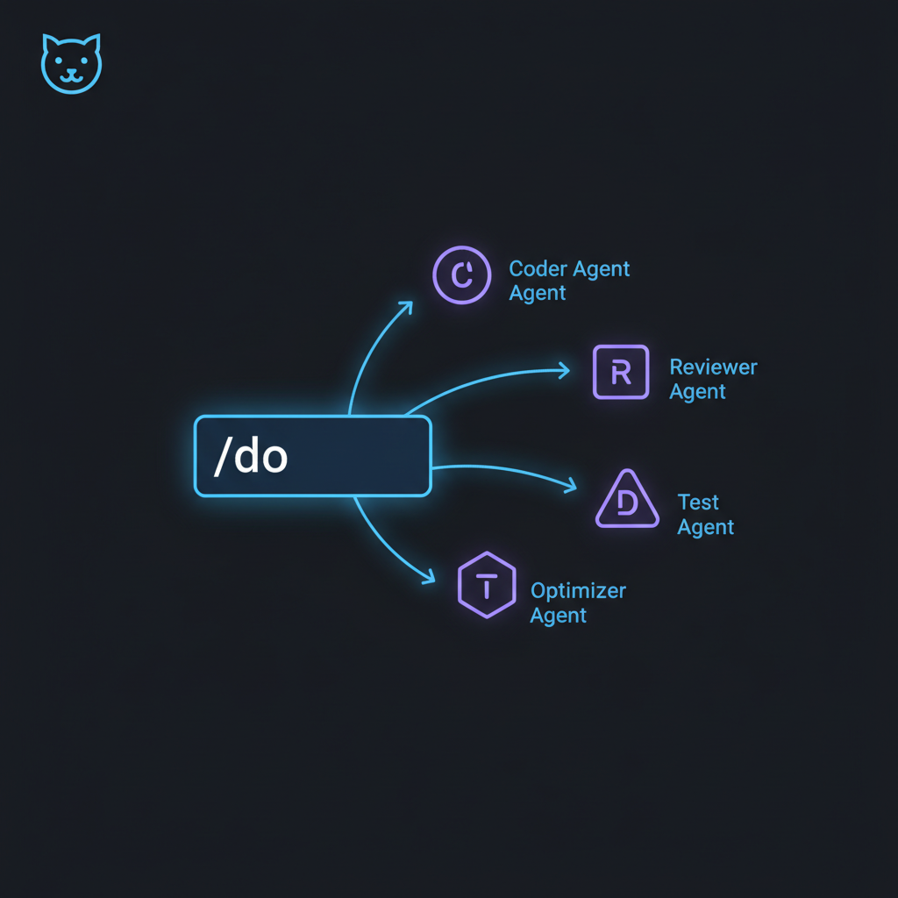

# VexJoy Agent



Essays and writing behind this toolkit live at [vexjoy.com](https://vexjoy.com).

VexJoy Agent connects plain-English requests to specialist agents, skills, and workflows. `/do` selects the knowledge and tools needed for your task. Hooks enforce specific checks, and scripts handle repeatable work.

The aim is to give capable models useful domain knowledge without making you learn the toolkit's catalog.

<!-- Counts here must match the Four Layers table. Both count active components. Verify both: python3 scripts/validate-doc-counts.py -->
43 agents, 46 skills, 71 hooks, 164 scripts. Agents carry domain knowledge, skills provide reusable methods, hooks enforce selected checks, and scripts handle repeatable plumbing.

Works across Claude Code (`/do`), Codex (`$do`), Factory (`/do`), Reasonix (`/do`), and Antigravity CLI (`/do`).

## What It Looks Like

```
$ claude

> /do debug this Go test

===================================================================
 ROUTING: debug a failing Go test
===================================================================
 Selected:
   -> Agent: golang-general-engineer - Go code and test tooling
   -> Skill: workflow - "debug" runs the systematic-debugging pipeline
   -> Pipeline: OBSERVE → HYPOTHESIZE → TEST → FIX → RECORD
 Invoking...
===================================================================

  OBSERVE: reproduced the failure with go test -run TestHealthCheck
  HYPOTHESIZE: pool timeout shorter than the health-check deadline
  TEST: the failure follows the timeout value
  FIX: raised the pool timeout; go test ./... passes
  RECORD: noted the cause for later sessions
```

The router pairs the Go agent with the `workflow` skill's debugging pipeline, then follows the task through each phase. The output is illustrative and abridged: the banner format, agent, skill, and phases are real; the run is an example.

## The Pipeline

```
  ROUTE        PLAN         EXECUTE      VERIFY       DELIVER      RECORD
 ┌──────┐    ┌──────┐    ┌──────┐    ┌──────┐    ┌──────┐    ┌──────┐
 │ /do  │───▶│ Task │───▶│Agent │───▶│Tests │───▶│  PR  │───▶│Route │
 │Router│    │ Plan │    │+Skill│    │Gates │    │Branch│    │Result│
 └──────┘    └──────┘    └──────┘    └──────┘    └──────┘    └──────┘
```

## /d — Jev-Powered Router

`/d` requires [TypeSafe's Jev](https://docs.typesafe.ai). Jev classifies the
request, checks that the selected route preserves the requested outcome, and
then dispatches the agent, skill, and pipeline.

Intent preservation is production behavior: `/d` restates the requested
outcome and gates dispatch on a Jev receipt for that exact proposed intent,
preventing an agent from quietly expanding an apple into an orchard. The gate
is an instruction in the `/d` skill, not a hook.

Choose either transport:

```bash
# Preferred: Jev through Vercel AI Gateway
export JEV_TRANSPORT=vercel
export AI_GATEWAY_API_KEY=...

# Alternative: Jev's direct API
export JEV_TRANSPORT=direct
export TYPESAFE_API_KEY=...
```

`JEV_TRANSPORT=auto` is the default. It prefers Vercel when
`AI_GATEWAY_API_KEY` is set, then uses the direct API when only
`TYPESAFE_API_KEY` is set. An explicit transport never silently switches to
the other one. The TypeSafe MCP plugin is not required for `/d`.

Intent-alignment judgments are recorded in `learning.db` without raw request
text. Receipts keep the Jev judge model separate from the executing agent's
configured model and effort level. View proposed-intent difference rates by
agent profile, judge model, and transport:

```bash
python3 scripts/jev-intent-stats.py --days 30
```

Example (illustrative):

```
> /d fix the flaky test in the payments module

  Intent alignment (/d):
    -> Restated outcome: Fix the flaky payments test without changing unrelated behavior.
    -> Jev: aligned

  ROUTING (/d): testing-automation-engineer + testing
  Source: jev (confidence: medium)
  Invoking...
```

## Anti-Rationalization

Skills ask for evidence rather than confidence.

| Agent Says | What Happens |
|---|---|
| "Code looks correct, skip tests" | The skill's exit gate asks for test output before the phase ends. |
| "Trivial change, no verification" | The skill still asks for evidence; at merge time, `ci-merge-gate` blocks `gh pr merge` until CI passes. |
| "Similar to before" | Skill demands case-specific proof. |
| "User is in a hurry" | Protocol overrides time pressure. |
| "I'm confident" | The skill asks for an exit code, not an assertion. |

These rows are skill and agent instructions, not hooks. No hook stops a session or a subagent from finishing without evidence. The Stop hooks are advisory (in this checkout, `stop-drift-guard` can wake the session again after it stops when its changes caused hook, doc-count, or routing drift), and `subagent-completion-guard`'s deny is not an output SubagentStop honors, so it never blocks in Claude Code. The hooks that do block cover specific actions: commits on `main` or `master`, pushes and PR creation before `/pr-review` records the commit (in every repo except non-fork `github.com/notque` ones), merges before CI passes, destructive commands, writes to credential files, and pipeline phases written without their artifact. The full list is in [Start Here](docs/start-here.md#gates-in-every-repo). Coverage depends on the runtime and tool path.

## Knowledge Work Is First-Class

The content engine researches, drafts in a calibrated voice, checks 397 writing patterns, and adapts finished pieces for each platform. `/frontend` (its HTML artifact mode) produces a self-contained report, deck, prototype, chart, or diagram.

## It Proves Its Own Changes

Toolkit changes use direct review and relevant checks. Model comparisons can settle specific uncertainties; they are not required for every edit. [PHILOSOPHY.md](docs/PHILOSOPHY.md) explains the validation policy.

The automated nightly evolution loop (the `toolkit` skill's evolution flow, `skills/meta/toolkit/references/toolkit-evolution.md`; it wrote to the gitignored `evolution-reports/`) ran regularly through mid-May 2026. It is currently dormant; recent evidence has come from manual PRs instead.

## Installation

You need Python 3.10+, git, and bash: Linux or macOS, or Git for Windows' bash. The installer runs pip, so it needs network access. npm is optional: it installs Jev's Vercel gateway, and without it `/d` falls back to `/do`.

```bash
git clone https://github.com/notque/vexjoy-agent.git ~/vexjoy-agent
cd ~/vexjoy-agent
./install.sh
```

Installs into `~/.claude/`, and into `~/.codex/`, `~/.factory/`, `~/.hermes/`, `~/.reasonix/`, `~/.gemini/` (Antigravity), and `~/.cline/` when that home directory exists. `install.sh` first creates the home of each runtime whose command is on PATH (not Cline's). `install.sh` wraps the `vexinstall` engine (`scripts/vexinstall/`). Each SessionStart in the checkout re-syncs every runtime through the same engine, and so does the `post-merge` git hook after `git pull`. Symlinks (default in a git checkout on Linux and macOS) follow `git pull`; `--copy` gives a stable snapshot and is the default on Windows.

The install also changes your machine outside those directories, and its hooks then run in every repo you open with Claude Code:

- It merges the toolkit's hook registrations and its `env` settings into `~/.claude/settings.json`, after backing up the old file.
- It installs `requirements.txt` with pip (`--break-system-packages` when pip supports it, else `--user`), writes `post-merge` and `pre-commit` hooks into this checkout's `.git/hooks`, and adds a managed block to `~/.bashrc`.
- Several hooks block actions in any repo: `git commit` on `main` or `master`, `git push` and `gh pr create` until `/pr-review` records the commit (in every repo except non-fork `github.com/notque` ones), and `gh pr merge` before CI passes.

Every change, its opt-out, and how to turn off a gate: [What the installer changes](docs/start-here.md#what-the-installer-changes).

| Flag | Effect |
|---|---|
| `--dry-run` | Print the plan; write nothing |
| `--target <t>` | Only `claude`, `codex`, `factory`, `hermes`, `reasonix`, `antigravity`, `cline`, or `all` |
| `--copy` / `--symlink` | Copy entries for a stable snapshot / link them to this checkout (the default in a main git checkout on Linux and macOS; copy is the default on Windows) |
| `--no-takeover` | Leave old unowned copies in place (default: move them to trash and replace) |
| `--uninstall` / `--rollback` | Remove owned entries and, with no `--target` or `--target claude`, rename install.sh's post-merge hook so git skips it / undo the last install or uninstall run (its trash and settings backup) |

Layout and safety rules: [docs/installer-layout.md](docs/installer-layout.md).

Want only part of the toolkit? Run `./install.sh --configure`, or copy `.local.example/profile.yaml` to `.local/profile.yaml` and edit it. Without a profile, the full toolkit installs. Details: [.local.example/README.md](.local.example/README.md).

| CLI | Entry Point |
|-----|-------------|
| Claude Code | `/do` |
| Codex | `$do` |
| Factory | `/do` |
| Reasonix | `/do` |
| Antigravity CLI | `/do` |

**Jev Auto-Compact plugin** (optional, requires `TYPESAFE_API_KEY`):

```bash
claude plugin marketplace add ./plugins/jev-auto-compact
claude plugin install jev-auto-compact@jev-auto-compact -y
```

Replaces generated compaction summaries with Jev-judged verbatim pruning after context reaches 60%. The plugin is a Claude Code function hook; the `CLAUDE_CODE_ENABLE_FUNCTION_HOOKS=1` setting the installer adds turns those on. Inspect recorded before/after tokens and duration with `python3 scripts/jev-compact-evidence.py`.

**Full setup:** [docs/start-here.md](docs/start-here.md)

<details>
<summary><b>Codex CLI Parity</b></summary>

Mirrors agents, skills, and supported hooks into `~/.codex/`. Codex v0.144.1+ runs **62 of the 76 hook registrations; 14 are unsupported**. A registration is one hook file on one event, so these are not unique hook files. Some run on native Codex events and the rest through `hooks/codex-hook-adapter.py`; `scripts/codex-hooks-allowlist.txt` lists each one.

The adapter converts `apply_patch` operations into the Write/Edit payload expected by existing guards. It cannot intercept writes through `unified_exec`, unmatched MCP tools, WebSearch, or other unsupported paths. PreCompact and Stop receive less telemetry than in Claude Code. This is expanded compatibility, not full parity.

After install or any hook-definition change, run `/hooks` in Codex and review the new definitions before trusting them. Codex hash-trusts hook commands and skips changed, unreviewed definitions.

</details>

<details>
<summary><b>Factory CLI Support</b></summary>

Mirrors agents (as "droids"), skills, and hooks into `~/.factory/`. The toolkit's hooks, with paths rewritten to `~/.factory/`, replace the `hooks` key of `~/.factory/settings.json`; its other keys stay.

</details>

<details>
<summary><b>Reasonix Support</b></summary>

Mirrors skills, scripts, and the hooks listed in `scripts/reasonix-hooks-allowlist.txt` into `~/.reasonix/`. Reasonix has no agent or custom-command surface; `/do` arrives as a skill. It exposes four events: PreToolUse, PostToolUse, UserPromptSubmit, and Stop. Only UserPromptSubmit and Stop hooks are wired, because the toolkit's tool hooks expect Claude tool names. MCP, model, and permissions in `~/.reasonix/config.json` remain user-owned.

</details>

<details>
<summary><b>Antigravity CLI Support</b></summary>

Mirrors agents, skills, hooks, and scripts into `~/.gemini/`, and writes the hooks listed in `scripts/agy-hooks-allowlist.txt` to `~/.gemini/config/hooks.json`. `hooks/agy-hook-adapter.py` maps Antigravity tool names (`run_command`, `write_file`, `edit_file`, `read_file`) to the Claude names the guards expect. One gate runs only here: `pretool-routing-gate` blocks commands and file edits until the model has printed its routing banner.

</details>

<details>
<summary><b>Token-saving mode</b></summary>

The toolkit supplies its own routing, domain knowledge, methodology, and enforcement. The default system prompt duplicates most of that.

```bash
claude --system-prompt "."
```

Strips built-in tool-use instructions. The toolkit's agents, skills, hooks, and CLAUDE.md provide the project-specific guidance.

Know the trade-off first. The default prompt also carries Claude Code's own guidance on tool use, git, and security, and new Claude Code releases update it. With `"."` you keep only the toolkit's instructions and the hooks in [Gates in every repo](docs/start-here.md#gates-in-every-repo).

</details>

## Four Layers

<!-- Counts here must match the intro line. Both count active components. Verify both: python3 scripts/validate-doc-counts.py -->

| Layer | Count | Does |
|---|---|---|
| Agents | 43 | Domain knowledge: idiom tables, failure mode catalogs, error-to-fix mappings |
| Skills | 46 | Reusable guidance and methodology for recurring work. |
| Hooks | 71 | Lifecycle checks, context injection, and telemetry. |
| Scripts | 164 | Repeatable validation, orchestration, and plumbing. |

The counts are active components: agents with a frontmatter `name`, skills not retired with `promoted_to`, hook files registered in `.claude/settings.json`, and the Python scripts in `scripts/`.

Full skill catalog: [docs/skills.md](docs/skills.md).

```
┌──────────────────────────────────────────────────┐
│  SKILL.md                                        │
│  ┌─ Frontmatter ──────────────────────────────┐  │
│  │ name, description,                         │  │
│  │ routing: triggers, pairs_with              │  │
│  └────────────────────────────────────────────┘  │
│  Modes or phases, with gates                     │
│  Reference table (which references/ to load)     │
│  Verification (evidence requirements)            │
└──────────────────────────────────────────────────┘
```

This is the common shape, not a schema. Every active skill declares routing triggers; most also add phases or modes, a table that loads `references/` files on demand, and a verification step.

## Built with the Toolkit

A game built entirely by Claude Code using these agents, skills, and pipelines:

<div align="center">
<video src="https://github.com/user-attachments/assets/0e74abeb-dc7e-42ba-8239-a7a98cb1ab09" width="100%" autoplay loop muted playsinline></video>
</div>

## Choose Your Path

**[I just want to use it](docs/start-here.md)** Install, learn `/do`, done.

**[I do knowledge work](docs/for-knowledge-workers.md)** Writing, research, data analysis, moderation, HTML artifacts. No code.

**[I'm a developer](docs/for-developers.md)** Architecture, extension points, adding agents and skills.

**[I'm an AI power user](docs/for-ai-wizards.md)** Routing tables, pipelines, hooks, telemetry DB.

**[I'm an AI agent](docs/for-claude-code.md)** Machine-dense inventory. Tables, paths, schemas.

## Philosophy

- **Outcome-first operation.** Describe the result; routing selects the relevant catalog entries.
- **Programs compute; models judge and generate.** Use deterministic code where the answer is computable.
- **Density.** Every word carries instruction, rule, or decision. Cut everything else.
- **Breadth over depth.** Right context ensures correctness. Unfocused context adds cost.
- **Enforce what has earned it.** A blocking hook's exit code enforces what instructions can't, for the actions it covers. Most quality gates are skill instructions, and a new check starts advisory until it proves its value.
- **Everything pipelines.** Complex work decomposes into phases. Phases have gates. Gates prevent cascading failures.

Full design philosophy: **[PHILOSOPHY.md](docs/PHILOSOPHY.md)**

## Maintenance

One report-only script surfaces upkeep work; it prints a digest and never edits, deletes, or blocks.

- `python3 scripts/stale-skill-scan.py --top 20` ranks stale skills and agents as pruning candidates. Run it quarterly; see [docs/deprecation-template.md](docs/deprecation-template.md).

Scheduled work follows the same boundary as everything else: judgment uses models; repeatable plumbing uses 164 scripts.

| Need | Use |
|---|---|
| Run a deterministic command on a schedule | `scripts/agent-scheduler.py` with `runner: "command"` |
| Run an agent judgment on a schedule, webhook, or file change | `scripts/agent-scheduler.py` with the default `runner: "claude"` |
| Install or remove a user crontab entry safely | `scripts/crontab-manager.py` |
| Audit shell cron reliability | the `deploy` skill's cron reference (`skills/infrastructure/deploy/references/cron-automation.md`) |
| Keep one interactive objective moving until criteria verify | the `workflow` skill's Objective Loop mode (`skills/process/workflow/references/ol-SPEC.md`) |

## Contributing

See [CONTRIBUTING.md](CONTRIBUTING.md).

## License

MIT. See [LICENSE](LICENSE).
