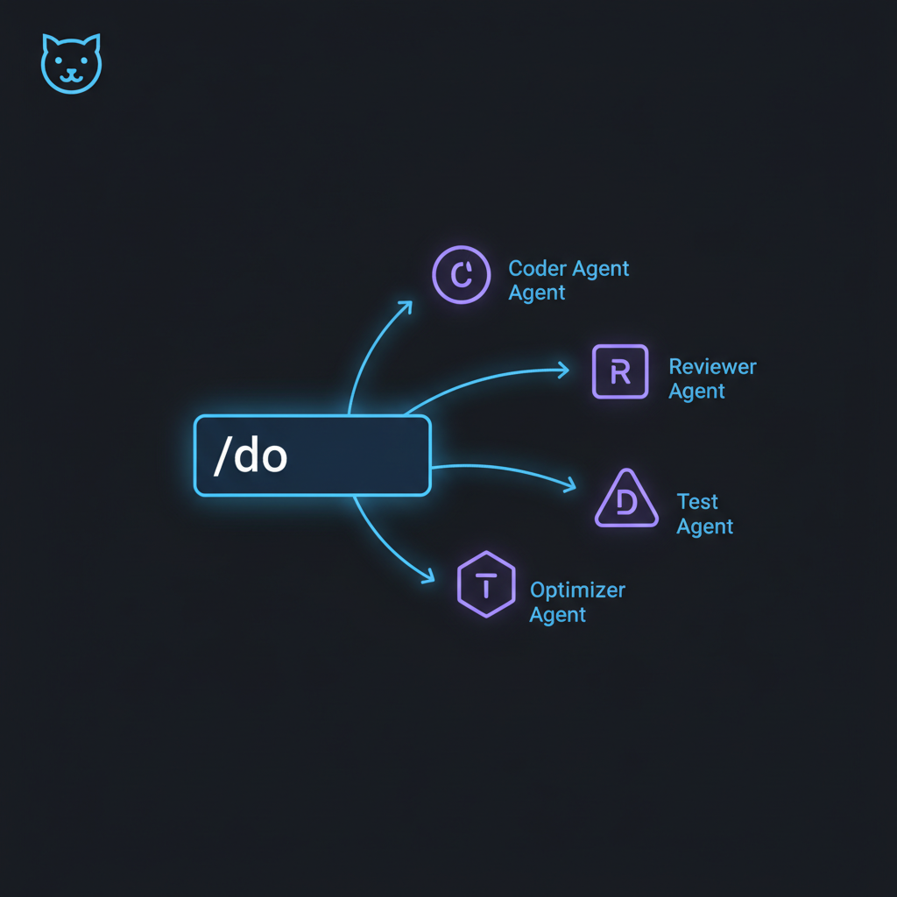

# VexJoy Agent



**Describe the outcome you want. VexJoy Agent picks the right skills, runs the workflow, checks its own work, and blocks unsafe actions before they land.**

AI coding CLIs fail in three predictable ways when left on autopilot: they ignore passive skill catalogs, cut verification corners when they feel confident, and quietly rewrite what you asked for. VexJoy Agent fixes all three with a front-door router (`/do`), an optional intent-verification gate (`/d`), reusable domain skills, and hard safety hooks.

<!-- Counts here must match the Four Layers table. Both count active components. Verify both: python3 scripts/validate-doc-counts.py -->
43 skills, 26 pipelines, 47 hooks, 163 scripts. Works across Claude Code (`/do`), Antigravity CLI (`/do`), Codex (`$do`), Factory (`/do`), Reasonix (`/do`), and Hermes. Essays behind the toolkit live at [vexjoy.com](https://vexjoy.com).

---

## Quick Start

Requires Python 3.10+, `git`, and `bash` (Linux, macOS, or Git for Windows bash) plus network access for `pip`. `npm` is optional (used for `/d`'s Vercel Jev transport; without it `/d` falls back to `/do`).

```bash
git clone https://github.com/notque/vexjoy-agent.git ~/vexjoy-agent
cd ~/vexjoy-agent
./install.sh
```

Then open Claude Code, Antigravity CLI, or Codex in any project and ask in plain English:

```text
/do debug the failing Go health-check test
/do review my diff for security and edge cases
/d  fix the flaky payment test without touching the billing API
/prompt --strict-scope harden token refresh without touching auth routes
```

You do not need to memorize skill names or slash commands. `/do` reads the live catalog, loads the matching skills and verification gates, and runs the job.

**What `./install.sh` changes on your machine:**
- Installs skills, hooks, and scripts into `~/.claude/` and every other detected runtime home (`~/.codex/`, `~/.gemini/`, `~/.factory/`, `~/.hermes/`, `~/.reasonix/`, and `~/.cline/` when present). Uses symlinks in a Linux/macOS git checkout (`--copy` is default on Windows) and re-syncs automatically on `git pull` and `SessionStart`.
- Merges toolkit hook registrations and `env` defaults into `~/.claude/settings.json` (after backing up your existing file), installs `requirements.txt` with `pip`, writes `post-merge` and `pre-commit` git hooks into this checkout, and adds a managed block to `~/.bashrc`.
- Turns on blocking safety gates across repos: no `git commit` on `main` or `master`, no `git push` or `gh pr create` before `/pr-review` records the commit (except non-fork `github.com/notque` repos), and no `gh pr merge` before CI passes.

Full details, opt-outs, and how to disable any gate: [What the installer changes](docs/start-here.md#what-the-installer-changes).

<details>
<summary><b>Installer flags, partial installs, and optional add-ons</b></summary>

| Flag | Effect |
|---|---|
| `--dry-run` | Print the plan; write nothing |
| `--target <t>` | Limit to `claude`, `codex`, `factory`, `hermes`, `reasonix`, `antigravity`, `cline`, or `all` |
| `--copy` / `--symlink` | Copy a stable snapshot / link to this checkout (symlink default on Linux/macOS; copy default on Windows) |
| `--configure` | Install only selected parts of the toolkit (or copy `.local.example/profile.yaml` to `.local/profile.yaml`; see [.local.example/README.md](.local.example/README.md)) |
| `--no-takeover` | Leave existing unowned files in place (default: move them to trash and replace) |
| `--uninstall` / `--rollback` | Remove owned entries / undo the last install or uninstall from its trash and settings backup |

Installer layout and safety rules: [docs/installer-layout.md](docs/installer-layout.md).

**Jev Auto-Compact plugin** (optional Claude Code plugin, requires `TYPESAFE_API_KEY`):

```bash
claude plugin marketplace add ./plugins/jev-auto-compact
claude plugin install jev-auto-compact@jev-auto-compact -y
```

Replaces generated compaction summaries with Jev-judged verbatim pruning after context reaches 60%. The installer enables Claude Code function hooks (`CLAUDE_CODE_ENABLE_FUNCTION_HOOKS=1`). Inspect before/after savings with `python3 scripts/jev-compact-evidence.py`.

**Token-saving mode** (optional):

```bash
claude --system-prompt "."
```

Strips Claude Code's default tool-use prompt so the toolkit's skills, hooks, and `CLAUDE.md` supply the guidance. Trade-off: you also drop Claude Code's built-in prompt updates and rely only on this toolkit's instructions and [gates](docs/start-here.md#gates-in-every-repo).

</details>

---

## Why `/do` and `/d` Exist

### `/do`: Make models actually use skills and run the process

A flat folder of 43 skills does not activate itself. Without an explicit router, models skip domain skills, skip multi-step procedures, and claim work is done without proof.

`/do` runs before work begins:
1. **Classifies scope** so simple work stays fast and big work gets structured.
2. **Reads the live manifest** of skills and pipelines and loads the domain knowledge + verification rules that fit your intent.
3. **Picks the right execution mode:**
   - **Pure Q&A / opinions** (zero edits or tools): answers directly in-thread with a one-line route note.
   - **Trivial & Simple tasks**: runs in the main thread with the skill loaded, avoiding a ~20k-token subagent cold start.
   - **Medium, Complex, parallel, or isolated tasks**: dispatches built-in workers (`general-purpose` on Claude Code, `self` or `research` on Antigravity) with the selected skills, task spec, and pipeline phases.

```text
$ claude

> /do debug this Go test

===================================================================
 ROUTING: debug a failing Go test
===================================================================
 Selected:
   -> Worker: general-purpose - Go debugging spans several files
   -> Skill: workflow - "debug" runs the systematic-debugging pipeline
   -> Extra Rigor: programming - Go code and test tooling
   -> Pipeline: OBSERVE → HYPOTHESIZE → TEST → FIX → RECORD
 Invoking...
===================================================================

  OBSERVE: reproduced the failure with go test -run TestHealthCheck
  HYPOTHESIZE: pool timeout shorter than the health-check deadline
  TEST: the failure follows the timeout value
  FIX: raised the pool timeout; go test ./... passes
  RECORD: noted the cause for later sessions
```

*(Illustrative run; banner format, skills, and pipeline phases are real.)*

```text
  ROUTE        PLAN         EXECUTE      VERIFY       DELIVER      RECORD
 ┌──────┐    ┌──────┐    ┌──────┐    ┌──────┐    ┌──────┐    ┌──────┐
 │ /do  │───▶│ Task │───▶│Worker│───▶│Tests │───▶│  PR  │───▶│Route │
 │Router│    │ Plan │    │+Skill│    │Gates │    │Branch│    │Result│
 └──────┘    └──────┘    └──────┘    └──────┘    └──────┘    └──────┘
```

### `/d`: Stop models from silently rewriting what you asked for

Models (especially Claude) frequently drift from your actual request: quietly expanding a small fix into a broad refactor ("turning an apple into an orchard"), or narrowing a full deliverable into a partial start. Asking the same model *"did you understand me?"* fails because it rationalizes its own misread.

`/d` uses [TypeSafe's Jev](https://docs.typesafe.ai) as an independent second pair of eyes on top of the exact same `/do` router and dispatch engine:
1. Restates the exact outcome it is about to deliver.
2. Sends your raw request and that restatement to Jev to check alignment.
3. Gates dispatch on a Jev receipt for that exact proposed intent (checked by `scripts/build-dispatch.py`, not a hook).

```text
> /d fix the flaky test in the payments module

  Intent alignment (/d):
    -> Restated outcome: Fix the flaky payments test without changing unrelated behavior.
    -> Jev: aligned

  ROUTING (/d): testing (main loop)
  Source: jev (confidence: medium)
  Invoking...
```

Configure either Jev transport (`JEV_TRANSPORT=auto` prefers Vercel when `AI_GATEWAY_API_KEY` is set, then direct when only `TYPESAFE_API_KEY` is set; an explicit transport never silently switches; no TypeSafe MCP plugin needed):

```bash
# Preferred: Jev through Vercel AI Gateway
export JEV_TRANSPORT=vercel
export AI_GATEWAY_API_KEY=...

# Alternative: Jev's direct API
export JEV_TRANSPORT=direct
export TYPESAFE_API_KEY=...
```

Intent-alignment receipts are stored in `learning.db` without raw prompt text. Measure drift rates across models, runtimes, judge models, and transports:

```bash
python3 scripts/jev-intent-stats.py --days 30
```

### `/prompt`: Compile underspecified requests and apply presets

For rough or ambiguous requests, `/prompt` grounds itself read-only against the repo, emits a 5-line task contract (outcome, out-of-scope boundaries, verification command, owned paths, and at most one open question), and hands the ratified contract straight to `/do` or `/d`.

Both `/prompt` and `/do` accept composable constraint presets (`--strict-scope`, `--spike`, `--review-only`, `--ship`, `--local-only`) that inject scope, review, and shipping rules into the task spec without rewriting boilerplate.

---

## What You Can Ask

VexJoy Agent handles both software engineering and knowledge work from the same prompt bar:

| Goal | Example prompt | What runs under the hood |
|---|---|---|
| **Debug & test** | `/do debug this Go test and add a regression check` | `workflow` (systematic debugging) + `programming` + `testing` exit gates |
| **Ship & review PRs** | `/do review my diff, push, and merge once CI is green` | `review` + `pr-workflow` + `ci-merge-gate` (blocks merge until all checks pass) |
| **Security & infra** | `/do audit this auth change for vulnerabilities` | `security` threat/diff review or `kubernetes` / `deploy` runbooks |
| **Deep research & docs** | `/do compare Postgres vs SQLite WAL limits with primary sources` | `research` multi-worker protocol with inline citations, gap checks, and PDF/Office-to-Markdown conversion |
| **Frontend & visual artifacts** | `/do build a clean dashboard / HTML deck for Q3 metrics` | `frontend` visual-craft & anti-slop guidelines, responsive checks, self-contained HTML artifacts |
| **Writing & editing** | `/do condense this design doc without losing any rules` | `writing` (voice fidelity, condensing, 397 writing patterns, anti-AI pass) |

Full catalog of all 43 skills: [docs/skills.md](docs/skills.md).

---

## Hard Safety Gates vs. Skill Checks

VexJoy separates **hard hooks** (code that blocks an action with a non-zero exit) from **skill gates** (instructions that demand proof before marking work done):

**Hooks that actually block** (coverage depends on runtime and tool path; full list in [Gates in every repo](docs/start-here.md#gates-in-every-repo)):
- Committing directly to `main` or `master`
- Pushing or creating a PR before `/pr-review` records the commit (in every repo except non-fork `github.com/notque` ones)
- Merging a PR (`gh pr merge`) while GitHub Actions checks are failing or still running
- Destructive commands, credential/secret writes, and skipping required pipeline phase artifacts
- Incomplete Medium/Complex agent dispatches (`pretool-dispatch-spec-gate` blocks dispatches missing the verbatim request, acceptance criteria, or repo-state handoff block by default; set `DISPATCH_SPEC_GATE_MODE=warn` to downgrade)
- On Antigravity: `pretool-routing-gate` blocks commands and edits until the routing banner is emitted

**Skill verification gates** (anti-rationalization instructions; Stop hooks are advisory, except `stop-drift-guard` in this checkout which wakes the session on hook, doc-count, or routing drift):

| Excuse a model tries | What the skill requires instead |
|---|---|
| "Code looks correct, skip tests" | Run the test suite and show the output before closing the phase. |
| "Trivial change, no verification" | Provide concrete execution proof; `ci-merge-gate` still blocks merge until CI passes. |
| "Similar to before" | Prove the current case directly. |
| "User is in a hurry" | Verification protocol overrides time pressure. |
| "I'm confident" | Show an exit code, not an assertion. |

---

## Supported CLIs

`AGENTS.md` is the single canonical rule file: Antigravity CLI and Codex read it natively, and Claude Code imports it through `CLAUDE.md` (`@AGENTS.md`).

| Tier | CLI | Entry point | Support level |
|---|---|---|---|
| **Tier 1** | **Claude Code** | `/do`, `/d` | Full parity: all skills, pipelines, 51 Python hook registrations, Jev plugins |
| **Tier 1** | **Antigravity CLI** | `/do`, `/d` | Full skills + adapted hooks via `hooks/agy-hook-adapter.py` + `pretool-routing-gate` |
| **Tier 1** | **Codex CLI** | `$do` | Full skills + 43 of 51 hook registrations via native events and `hooks/codex-hook-adapter.py` |
| **Tier 2** | **Factory** | `/do` | Skills, droids, and rewritten hooks in `~/.factory/settings.json` |
| **Tier 2** | **Reasonix** | `/do` | Skills, scripts, and UserPromptSubmit/Stop hooks from `scripts/reasonix-hooks-allowlist.txt` |
| **Tier 2** | **Hermes** | skills | Skills synced into `~/.hermes/` (no hook surface) |
| **Tier 2** | **Cline** | skills | Synced when `~/.cline/` exists |

<details>
<summary><b>Runtime-specific notes (Codex, Antigravity, Factory, Reasonix)</b></summary>

- **Codex CLI (`~/.codex/`):** Codex v0.144.1+ runs **43 of the 51 hook registrations; 8 are unsupported** (one registration is one hook file on one event, listed in `scripts/codex-hooks-allowlist.txt`). `hooks/codex-hook-adapter.py` converts `apply_patch` into Write/Edit payloads for guards; it cannot intercept `unified_exec`, unmatched MCP tools, or WebSearch, and PreCompact/Stop carry less telemetry than Claude Code. After installing or updating hooks, run `/hooks` inside Codex to review and trust updated command hashes.
- **Antigravity CLI (`~/.gemini/`):** Mirrors skills, hooks, and scripts into `~/.gemini/` and writes `~/.gemini/config/hooks.json` from `scripts/agy-hooks-allowlist.txt`. `hooks/agy-hook-adapter.py` maps Antigravity tool names (`run_command`, `write_file`, `edit_file`, `read_file`) to the Claude names guards expect.
- **Factory CLI (`~/.factory/`):** Mirrors skills, droids, and hooks with paths rewritten to `~/.factory/`; replaces only the `hooks` key in `~/.factory/settings.json`.
- **Reasonix (`~/.reasonix/`):** Mirrors skills, scripts, and the non-tool hooks in `scripts/reasonix-hooks-allowlist.txt`. MCP, model, and permissions in `~/.reasonix/config.json` stay user-owned.

</details>

---

## Built with the Toolkit

A game built by Claude Code using these skills and pipelines:

<div align="center">
<video src="https://github.com/user-attachments/assets/0e74abeb-dc7e-42ba-8239-a7a98cb1ab09" width="100%" autoplay loop muted playsinline></video>
</div>

---

## Choose Your Path

- **[Start here](docs/start-here.md)**: Install, run `/do` and `/d`, see every blocking gate and how to opt out.
- **[Knowledge workers](docs/for-knowledge-workers.md)**: Writing, deep research, data analysis, HTML artifacts. No code required.
- **[Developers](docs/for-developers.md)**: Architecture, extension points, authoring skills and references.
- **[AI power users](docs/for-ai-wizards.md)**: Routing tables, pipelines, hooks, `learning.db` telemetry.
- **[AI agents](docs/for-claude-code.md)**: Dense inventory of tables, paths, and schemas.

---

## Four Layers

<!-- Counts here must match the intro line. Both count active components. Verify both: python3 scripts/validate-doc-counts.py -->

| Layer | Count | Does |
|---|---|---|
| Agents | 0 | Retired (plans/009): their domain knowledge moved into skill references. Private overlay agents still install from overlays. |
| Skills | 43 | Domain knowledge and methodology for recurring work: idiom tables, failure mode catalogs, error-to-fix mappings. |
| Hooks | 47 | Lifecycle checks, context injection, and telemetry. |
| Scripts | 163 | Repeatable validation, orchestration, and plumbing. |

Counts reflect active components on disk: agents with a frontmatter `name`, skills not retired with `promoted_to`, hook files registered in `.claude/settings.json`, and Python scripts in `scripts/`.

```text
┌──────────────────────────────────────────────────┐
│  SKILL.md                                        │
│  ┌─ Frontmatter ──────────────────────────────┐  │
│  │ name, description,                         │  │
│  │ routing: triggers, pairs_with              │  │
│  └────────────────────────────────────────────┘  │
│  Modes or phases, with gates                     │
│  Reference table (load references/ on demand)    │
│  Verification (evidence requirements)            │
└──────────────────────────────────────────────────┘
```

## Philosophy

- **Outcome-first operation.** Describe the result; routing loads the matching catalog entries.
- **Programs compute; models judge and generate.** Use deterministic scripts wherever the answer is computable.
- **Density.** Every word carries an instruction, rule, or decision; cut everything else.
- **Right context over big context.** Load only the references a task needs; keep entry points slim.
- **Enforce what has earned it.** Hard hooks block concrete hazards; skill gates verify work; new checks prove themselves advisory first.
- **Evidence over assertions.** Toolkit edits ship through direct review, tests, and CI checks, not guesses.

Full design philosophy: **[PHILOSOPHY.md](docs/PHILOSOPHY.md)**.

## Maintenance and Scheduling

Scheduled work follows the same boundary: repeatable plumbing runs in scripts, and judgment invokes a model.

| Need | Use |
|---|---|
| Diagnose prompt drift, scope expansion, and gate blocks | `python3 scripts/prompt-diagnostics.py --days 30` |
| Run the golden prompt effectiveness eval suite | `python3 scripts/prompt-eval.py` |
| Find stale skills to prune (report-only) | `python3 scripts/stale-skill-scan.py --top 20` (see [docs/deprecation-template.md](docs/deprecation-template.md)) |
| Run a deterministic command on a schedule | `scripts/agent-scheduler.py` with `runner: "command"` |
| Run agent judgment on a schedule, webhook, or file change | `scripts/agent-scheduler.py` with the default `runner: "claude"` |
| Install or remove a user crontab entry safely | `scripts/crontab-manager.py` |
| Audit shell cron reliability | `skills/infrastructure/deploy/references/cron-automation.md` |
| Keep an interactive objective moving until criteria verify | `skills/process/workflow/references/ol-SPEC.md` |

## Contributing & License

See [CONTRIBUTING.md](CONTRIBUTING.md). Licensed under MIT. See [LICENSE](LICENSE).
