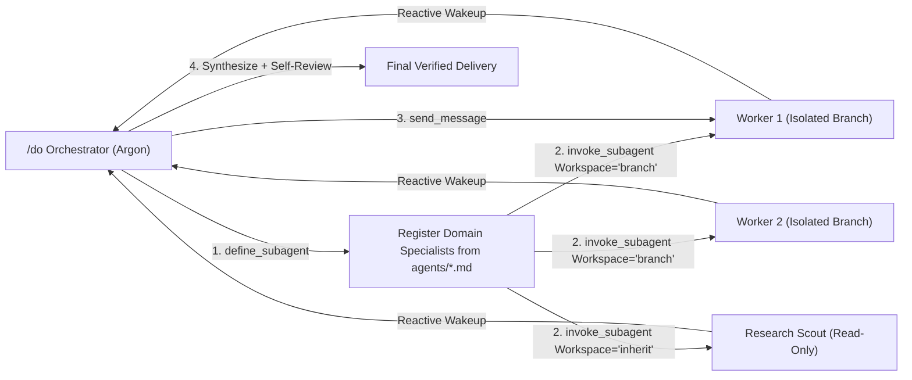

# Antigravity CLI (`agy`) & Google AI (Argon) Execution Reference for `/do`

Use this reference when running `/do` (or `/d`) inside the Antigravity CLI (`agy`) or with Google AI models (`gemini-4-argon`, `gemini-3.8-flash`). It maps every phase of VexJoy's `/do` router to Antigravity's native multi-agent primitives (`/teamwork`, `run_workflow`), autonomous deep-work loop (`/goal`), slash commands, brain artifacts, and hook translation layer.

---

## 1. Runtime Detection & `build-dispatch.py` Contract

Detect the active harness before Phase 4 dispatch:

```bash
python3 "$SDIR/detect-workflow-capability.py"
# -> {"harness": "antigravity", "workflow_capable": true}
```

When `harness == "antigravity"` (or `ANTIGRAVITY_AGENT=1`):
1. Pass `"provider": "google"` (or `"antigravity"`) in the `build-dispatch.py` JSON payload.
2. Select models from the **Google AI Model Selection Table** below instead of Claude model names.
3. Dispatch workers using Antigravity's native subagent tools (`define_subagent`, `invoke_subagent`, `send_message`, `manage_subagents`) or Python `run_workflow` tool when present in your live tool list.

---

## 2. Google AI (Argon & Flash) Model Selection

Select `model` (and optional `model_effort` or `model_policy`) in `build-dispatch.py` based on task risk and complexity, and map it to the `Model` parameter of `invoke_subagent` / `run_workflow`:

### 2.1 Automatic Policy Tiers (`model_policy` with `provider="google"`)

| `model_policy` | `build-dispatch.py` Emitted Marker | CLI Model Variant | `invoke_subagent` `Model` Arg | When to Select |
|---|---|---|---|---|
| `low-risk` | `model=gemini-3.8-flash effort=low` | `gemini-3.8-flash-low` | `"flash"` or `"flash_lite"` | Mechanical edits, file lookups, formatting, comment/doc fixes, read-only scouting |
| `standard` | `model=gemini-4-argon effort=medium` | `gemini-4-argon-medium` | `"inherit"` (or `"pro"`) | Feature implementation in existing patterns, standard debugging, unit/integration tests |
| `high-risk` | `model=gemini-4-argon-high effort=high` | `gemini-4-argon-high` | `"pro"` or `"inherit"` | Multi-file refactors, concurrency, security-sensitive paths, complex architecture |
| `max-power` | `model=gemini-4-argon-high effort=max` | `gemini-4-argon-high` (`--effort max`) | `"pro"` | Escalation tier after a miss, deep root-cause debugging, adversarial security audit (requires `manual_model_override: true`) |

### 2.2 Task-Type Routing Table for Google AI

| Task Type | `build-dispatch.py` `model` | `model_effort` | `invoke_subagent` `Model` | Escalation Path on Verification Miss |
|---|---|---|---|---|
| Locate, lookup, cite lines, inventory | `gemini-3.8-flash` | `low` | `flash` (on `research` subagent) | `gemini-4-argon` (`medium`) |
| Mechanical edit (rename, config, boilerplate) | `gemini-3.8-flash` | `medium` | `flash` | `gemini-4-argon` (`medium`) |
| Code review / planted-bug scan | `gemini-4-argon` | `medium` | `inherit` | `gemini-4-argon-high` (`high`) |
| Debug: root cause + regression test | `gemini-4-argon` | `medium` | `inherit` | `gemini-4-argon-high` (`high`) |
| Feature implementation (multi-file) | `gemini-4-argon` | `medium` | `inherit` | `gemini-4-argon-high` (`high`) |
| Complex architecture / security / migration | `gemini-4-argon-high` | `high` | `pro` | `gemini-4-argon-high` (`max`, `manual_model_override: true`) |

### 2.3 Execution Tier Architecture in Antigravity CLI

In Antigravity CLI, all non-trivial tasks follow VexJoy's orchestrator contract: the main thread orchestrates and delegates all execution to subagents. Custom agents are registered via `define_subagent` from `agents/<name>.md` before `invoke_subagent`:

| Complexity Tier | Execution Mode | Agent Mechanism | Skill Mechanism |
|---|---|---|---|
| **Trivial** | Direct in-thread | Handled directly (single user-named file typo/fix) | None |
| **Simple / Medium** | Single subagent dispatch | Register specialist via `define_subagent` from `agents/<name>.md`; dispatch via `invoke_subagent` (`Workspace="inherit"`) | Subagent reads `~/.gemini/skills/<skill>/SKILL.md` as instructed by `build-dispatch.py` |
| **Complex / Fan-out** | Multi-agent dispatch (`/teamwork`) | Register via `define_subagent` from `agents/<name>.md`; dispatch via `invoke_subagent` (`Workspace="branch"` or `"share"`) | Subagent reads `~/.gemini/skills/<skill>/SKILL.md` as instructed by `build-dispatch.py` |

**Context Gathering Boundary (Phase 3 Step G)**:
Reading repository status (`git status -s`, `git branch`) and exploring up to 5 files in the main thread is explicitly permitted as orchestrator routing work to populate the Task Spec prior to subagent dispatch (`skills/meta/do/SKILL.md#L25`).

**Plan Approval Continuation Protocol**:
When the user approves an artifact or plan (e.g., `[Approved] <filename>`, `proceed`, `continue`), the orchestrator immediately resumes execution of the approved plan. Do not restart single-agent `/do` routing or collapse multi-agent streams into one monolithic subagent.

**No Multi-Subagent Collapse Rule (HARD CONSTRAINT)**:
When a task breakdown, job package, or Phase 1 classification plans multiple subagents (e.g., Subagents A/B/C/D), the orchestrator MUST invoke each subagent individually via `define_subagent` and `invoke_subagent` (or `run_workflow`). Collapsing multiple planned subagents into a single monolithic subagent prompt is strictly prohibited.

---

## 3. Multi-Agent Teamwork (`/teamwork` Engine for Complex Tasks)

When Phase 1 classifies a request as `Complex` (or Phase 2 selects multiple `agents` for parallel fan-out), execute using Antigravity's `/teamwork` architecture:



### Step 1: Register Domain Specialists (`define_subagent`)
Antigravity ships built-in `self` (full tool access), `research` (read-only sandbox), and `image-generator` subagents. To dispatch a specialized VexJoy agent (such as `python-general-engineer`, `golang-general-engineer`, `reviewer-system`):
1. Extract persona definition and permissions via `scripts/build-subagent-spec.py`:
   ```bash
   python3 scripts/build-subagent-spec.py --agent <agent-name> --format define_subagent
   ```
2. Call `define_subagent`:
   - `Name`: `"<agent-name>"`
   - `Description`: Specialist domain summary from frontmatter.
   - `SystemPrompt`: Compiled agent body + `agents/base-instructions.md` rules.
   - `EnableWriteTools`: `true` for implementers; `false` for reviewers/scouts.
   - `EnableMCPTools`: `true` when MCP documentation or external tools are needed.
   - `EnableSubagentTools`: `true` only for coordinators (`project-coordinator-engineer`, `pipeline-orchestrator-engineer`).

#### Antigravity SDK Programmatic Equivalents:
In the Python SDK (`google-antigravity`), personas and permissions map directly to `types.SubagentConfig` or `LocalAgentConfig`:
```python
from google_antigravity import types

# Programmatic equivalent generated via `scripts/build-subagent-spec.py --agent <name> --format sdk`
worker_config = types.SubagentConfig(
    name="python-general-engineer",
    description="Python development: features, debugging, code review, performance",
    system_instruction="<compiled system prompt>",
    capabilities=types.CapabilitiesConfig(
        enable_write_tools=True,
        enable_mcp_tools=False,
        enable_subagents=False,
    ),
)
```

#### Antigravity SDK Tool Permission Matrix for Specialists:
| Specialist Category | Example Agents | `EnableWriteTools` | `EnableMCPTools` | `EnableSubagentTools` | SDK Equivalent |
|---|---|---|---|---|---|
| **Builders / Implementers** | `python-general-engineer`, `typescript-frontend-engineer` | `true` | `false` (or `true` if needed) | `false` | ReadWrite BuiltinTools |
| **Reviewers & Auditors** | `reviewer-code`, `reviewer-system`, `reviewer-perspectives` | `false` | `false` | `false` | ReadOnly Policy (`BuiltinTools.read_only()`) |
| **Scouts & Researchers** | `research-subagent-executor` | `false` | `true` | `false` | Sandboxed ReadOnly + Web/MCP |
| **Coordinators / Planners** | `project-coordinator-engineer`, `pipeline-orchestrator-engineer` | `true` | `true` | `true` | Full capabilities (`enable_subagents=True`) |

### Step 2: Dispatch with Native Workspace Isolation (`invoke_subagent`)
1. Run `build-dispatch.py` **once per agent** (or use `--subagent-spec`) so each worker receives its own `[do-route]` marker line, scoped `task_spec.files`, and `ownership` boundaries:
   ```bash
   python3 scripts/build-dispatch.py --json '<decision>' --subagent-spec
   ```
2. **Skill Context Injection**: For Antigravity (`provider="google"` or `"antigravity"`), `build-dispatch.py` inlines the primary skill's operational summary directly into the prompt directive alongside `Read and follow ~/.gemini/skills/<skill>/SKILL.md`. This eliminates the cold-start latency of subagents spending their first turn reading skill files.
3. Call `invoke_subagent(TypeName, Role, Prompt, Model, Workspace)`:
   - **`Workspace="branch"`**: Creates an isolated workspace branched/cloned from the parent. **Mandatory** when parallel implementers edit files concurrently (replaces manual `git worktree` creation and prevents merge conflicts).
   - **`Workspace="share"`**: Shares the underlying repository metadata (worktree-style) for lightweight independent branching without duplicating storage.
   - **`Workspace="inherit"`**: Uses the parent workspace directly. **Default** for read-only reviewers (`reviewer-*`), scouts (`research-subagent-executor`), and single-agent sequential work where files do not collide.

#### Workspace Selection Guidelines:
| Agent Role | Primary Activity | Recommended Workspace | Rationale |
|---|---|---|---|
| **Implementer / Builder** | Code changes, refactoring | `Workspace="branch"` | Prevents file corruption and collision during parallel edits. |
| **Reviewer / Auditor** | Read-only inspection | `Workspace="inherit"` | Fast start, reads caller workspace state directly without cloning. |
| **Scout / Researcher** | Search, codebase scanning | `Workspace="inherit"` | Zero storage overhead, shared read access to project directory. |
| **Single Worker (Sequential)** | Contained fix | `Workspace="inherit"` | No parallel risk; fast execution in the active workspace. |

### Step 3: Reactive Wakeup & Stateful Continuation (`send_message`)
- **Zero Polling Rule (HARD CONSTRAINT)**: `invoke_subagent` launches asynchronously. After invoking subagents, **do not poll in a loop or run shell `sleep` commands**. Either perform independent non-dependent work or stop calling tools to end your turn; Antigravity automatically wakes you when a subagent replies or completes.
- **Continue Existing Subagents via `send_message`**: When a worker needs a follow-up fix, test retry, or review correction, call `send_message(Recipient="<conversationId>", Message="...")` instead of calling `invoke_subagent` again. The existing subagent retains its full file context and reasoning trajectory.

### Step 4: Lifecycle & 3-Strike Circuit Breaker (`manage_subagents`)
- Use `manage_subagents(Action="list")` to inspect live subagent states when coordinating a large fan-out.
- If a subagent hits the 3-strike verification failure limit (`quality-loop.md` Phase 7) or enters a loop, call `manage_subagents(Action="kill", ConversationIds=["<conversationId>"])` to terminate it and clean up its branched workspace while preserving logs and artifacts.

---

## 4. Deterministic Python Workflows (`run_workflow` Tool)

When `run_workflow` is available in your active tool list and Phase 2 selected a multi-phase pipeline (or `Complex` fan-out), you can execute a deterministic Python orchestration script instead of manual turn-by-turn handoffs:

- **Reference Template**: `skills/process/workflow/references/fan-out-workflow.py`
- **Core Primitives**:
  - `phase("Phase Name")`: Declares a named workflow phase in the UI.
  - `await agent(prompt, schema=..., role=..., type_name=..., workspace="branch"|"share"|"inherit", model="inherit"|"flash"|"pro")`: Spawns a subagent and validates its structured output against `schema` (Pydantic `BaseModel` or JSON Schema).
  - `await parallel([agent(...), agent(...)])`: Runs independent workers concurrently and gathers results.
  - `await pipeline([step1, step2])`: Chains sequential stages where each stage consumes the prior output.
  - `trajectory(result)`: Inspects the subagent's execution trajectory (`steps`, `tool_calls`, `files_modified`) for deterministic quality-gate verification before advancing to the next phase.
- **Telemetry Preservation**: Include the `[do-route]` marker generated by `build-dispatch.py` at line start inside each worker `prompt` string in the Python workflow script; `hooks/agy-hook-adapter.py` maps `run_workflow` (`Script`) to `Workflow` (`script`) so `hooks/routing-decision-recorder.py` records every worker marker automatically.

---

## 5. Deep Autonomous Work (`/goal` Mode Integration)

When the user invokes `/do` alongside `/goal` (or requests `<afk-mode>`, "loop until done", or an objective with verifiable done-criteria):

1. **Checklist Grounding**: Create and maintain `<appDataDir>/brain/<conversation-id>/task.md` mapping every explicit deliverable to concrete verification evidence.
2. **Quality-Loop Enforcement**: Execute all applicable stages of `references/quality-loop.md` (`PLAN` → `IMPLEMENT` → `VERIFY` → `REVIEW` → `FIX` → `EVALUATE` → `LIVE-VALIDATE`).
3. **Stop Hook Continuation Protocol**:
   - In `/goal` mode, Antigravity's `Stop` hook blocks termination until every deliverable is verified with fresh execution output (test results, lint, build logs, `git status`).
   - **Never** emit `<!-- GOAL_COMPLETE -->` while any checklist item is unverified, while tests fail, or while only a plan exists for an implementation request.
   - Emit `<!-- GOAL_COMPLETE -->` at the end of your final response **only** after all deliverables and verification gates pass.
   - Emit `<!-- GOAL_CANCELLED -->` only if the user explicitly asks to cancel or stop the goal.

---

## 6. Incorporating All Antigravity CLI Slash Commands & Capabilities

`/do` evaluates and incorporates every native Antigravity CLI slash command and tool into its 6-phase pipeline:

| Antigravity Command / Tool | `/do` Phase | How `/do` Incorporates or Recommends It |
|---|---|---|
| **`/teamwork`** (`define_subagent`, `invoke_subagent`, `send_message`, `manage_subagents`) | Phase 2 & Phase 4 (Complex / Fan-Out) | Directly executes parallel specialist fan-out with `Workspace="branch"\|"share"` isolation and `send_message` iterative handoffs. Recommend `/teamwork` when the user wants a persistent autonomous agent team across an entire project. |
| **`/goal`** (`<!-- GOAL_COMPLETE -->` + `Stop` hook loop) | Phase 3 & Phase 4.5 (Objective / Deep Work) | Couples VexJoy's `objective-loop` and `quality-loop.md` with `/goal` completion gates so long-running tasks never stop prematurely. Recommend `/goal` for overnight or multi-hour autonomous runs. |
| **`/plan`** (`implementation_plan.md` + `walkthrough.md` in `<appDataDir>/brain/<conversation-id>/`) | Phase 4 Step 1 & Phase 5 | Writes structured brain artifacts (`implementation_plan.md` with `ArtifactMetadata: {RequestFeedback: true, UserFacing: true}`) for user review before risky/complex changes, plus `task_plan.md` for repo-local checkpointing and `walkthrough.md` at completion. |
| **`/grill-me`** + **`ask_question`** tool | Phase 3 (Ambiguity Gate / Depth-First Interview) | Uses Antigravity's native `ask_question` tool (`questions` array, unnumbered `options`, `(Recommended)` prefix on first option, `is_multi_select`) to batch independent decision frontiers (`pl-depth-first-interview.md`). Recommend `/grill-me` when the user wants an exhaustive interactive design interview. |
| **`/boost`** (Deep Thinking + Multi-Perspective Verification + Scratch Prototyping) | Phase 3 & Phase 4.5 (`high-risk` / `max-power`) | Escalates to `gemini-4-argon-high` (`effort: "high"` or `"max"`), runs multi-perspective review fan-out (`reviewer-code`, `reviewer-system`, `reviewer-domain`, `reviewer-perspectives`), and builds empirical prototypes (`pl-empirical-prototype.md`) in `<appDataDir>/brain/<conversation-id>/scratch/`. |
| **`/browser`** | Phase 4.5 Stage 6 (`LIVE-VALIDATE`) | Validates web applications, UI components, and visual regressions in a live browser. |
| **`/schedule`** (`schedule` tool) & **`/automation`** (Sidecars) | Phase 4 (Async Monitoring / Recurring Tasks) | Uses the native `schedule` tool (`DurationSeconds` or `CronExpression` + `TimerCondition`) instead of bash `sleep` polling; uses `~/.gemini/config/sidecars/<id>/sidecar.json` (`automation` skill) for standing background daemons. |
| **`/compact`** | Phase Boundaries (Context Hygiene) | When `suggest-compact.py` or context length signals pressure between phases, checkpoints state to `task_plan.md` and brain artifacts, then recommends `/compact`. |
| **`/learn`** | Phase 5 (Post-Task Learning & Rule Graduation) | Records routing and error learnings to `learning.db` (`rules-distill-trigger.py`) and graduates durable workflow corrections into `.agents/rules/*.md` or `GEMINI.md` (with `trigger: always_on`, `glob`, `manual`, or `model_decision`). |

---

## 7. Google AI (Argon) Best Practices & Sandbox Discipline

1. **Sandbox-First Command Execution (`run_command`)**:
   - Always run commands in Standard Sandbox Mode (`BypassSandbox: false`) first.
   - Keep command shapes prefix-matchable for auto-approval: invoke target binaries directly (`git`, `pytest`, `python3`), avoid unnecessary command substitutions `$(...)` or wrapper binaries (`env`, `eval`), and split unsandboxed network steps from local preparation/test steps.
2. **Exact Tool & Symbol Grounding**:
   - Format all file and symbol references as clickable Markdown links using `file://` (`[build-dispatch.py](file:///abs/path/scripts/build-dispatch.py#L1-L50)`).
   - Use `read_file`, `edit_file`, and `write_file` instead of shell `cat`/`sed`/`awk` for file operations so `PostToolUse` hooks (`edit_file|write_file`) and file backups trigger deterministically.
3. **Writing Style Precedence**:
   - Follow `CLAUDE.md` / `GEMINI.md` precedence: **Completeness floor** (never omit required technical facts or verification evidence) > **Google Developer Documentation Style** (active voice, second person, context-before-instruction) > **Dense-Complete conciseness**.

---

## 8. Gemini Turn-1 Routing Invariants & Hook Enforcement

Gemini models (`gemini-3.8-flash`, `gemini-4-argon`) possess an aggressive function-calling bias and may attempt tool execution before emitting conversational preamble or routing banners.

1. **Turn-1 Output Invariant**:
   - On non-trivial requests, the very first turn must output the `/do` CLASSIFY and ROUTING banner as user-facing text before invoking mutating tools.
   - Refrain from retroactive banner creation at the conclusion of execution.
2. **Mechanical Enforcement**:
   - `hooks/gemini-turn-gate-userprompt.py` (`PreInvocation`) inspects incoming prompts, initializes routing state, and injects the Turn-1 mandate.
   - `hooks/pretool-routing-gate.py` (`PreToolUse`) permits read-only inspection (`read_file`, inspection commands like `git status`) but strictly denies mutating commands (`cargo`, `git commit`, `edit_file`) until the routing banner is emitted.
   - `invoke_subagent` and `run_workflow` immediately satisfy routing requirements.

---

## 9. Antigravity Lifecycle Events & Hooks Integration

The Antigravity SDK architecture relies on event-driven hooks to govern execution, validate policies, and track metrics. VexJoy integrates with these lifecycle points via `hooks/agy-hook-adapter.py`:

| Antigravity Hook | Lifecycle Trigger | VexJoy Integration & Behavior |
|---|---|---|
| **`SessionStart`** | New agent session initialized | Reads operator profile, clears stale run caches, and injects session-level environment context. |
| **`PreInvocation`** | Model turn starts (user prompt or wakeup) | Drains deferred context from prior tool calls, enforces Turn-1 routing invariant, and verifies active gates. |
| **`PreToolUse`** | Tool call emitted before execution | Enforces permission policies (`allow`, `deny`, `ask`), prevents mutating commands prior to routing, checks review gates before `git push`, and translates input modifications via `overwrite`. |
| **`PostToolUse`** | Tool execution finishes | Captures tool output and errors (`on_tool_error`), records diagnostics, and queues advisory context for delivery in the next model turn without breaking tool stdout format. |
| **`PostInvocation`** | Model finishes turn before reply | Determines termination behavior (`terminate` or `force_continue`) and updates turn counters. |
| **`Stop`** | User/agent attempts session completion | Blocks early termination if incomplete checklist items or unverified deliverables remain (`/goal` quality loop enforcement). |


